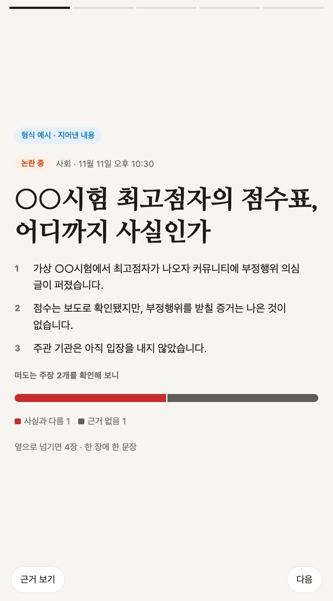
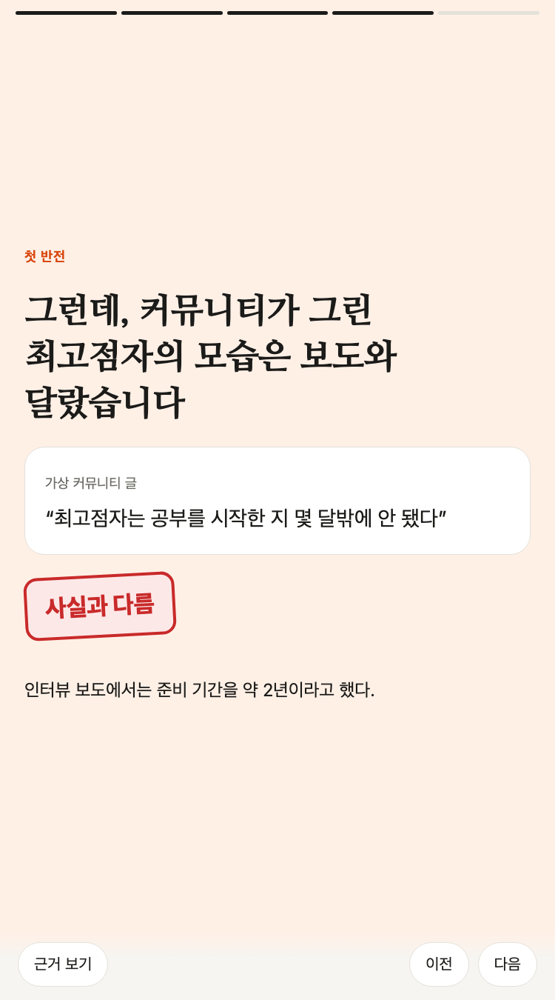

# 이슈 브리핑 (실험)

커뮤니티와 실시간 검색어에서 화제가 된 이슈를 골라, 그 이슈를 두고 떠도는 주장을 하나씩 원문과 대조해 판정하는 실험입니다. 결과는 휴대폰에서 옆으로 넘겨 읽는 짧은 덱으로 만듭니다. 일일 데스크(방송 소재 카드)와는 별개로 돌고, 아직 공개 발행은 하지 않습니다.

## 왜 판정 덱인가

화제가 된 이슈에는 사실과 짐작이 섞여 돕니다. 요약 기사나 카드뉴스는 둘을 한 문장에 담기 쉽습니다. 이 덱은 주장마다 판정을 따로 붙여서, 무엇이 확인됐고 무엇이 아직 말뿐인지를 장마다 나눠 보여 줍니다.

{ width="300" }
{ width="300" }

위 화면은 형식을 보이려고 지어낸 예시입니다. 실제 사건·매체·인물이 아닙니다.

## 덱의 생김새

- 한 장에 문장 하나와 그림 하나를 둡니다. 장 제목은 문장이고, 제목만 넘겨 읽어도 줄거리가 되게 씁니다. 슈카월드 방송 슬라이드의 구성 분석(`tracks/syuka/`)에서 가져온 규칙입니다.
- 첫 장은 30초 요약 세 줄과, 덱 안 판정을 모은 막대입니다.
- 마지막 장은 요약하지 않고 남은 질문으로 닫습니다.
- 장마다 "근거 보기"를 누르면 그 장의 출처만 열립니다.

장 유형은 일곱 가지입니다.

| 유형 | 쓰임 |
|---|---|
| 표지 | 상태(진행 중·결론 남·논란 중), 요약 세 줄, 판정 막대 |
| 숫자 | 큰 숫자 하나와 단위 |
| 판정 | 떠도는 주장 하나, 누가 말했나, 판정, 판정 이유 |
| 막대 | 몇 개 값을 견주는 막대 |
| 카드 | 숫자 카드 두세 개 |
| 글 | 그림이 필요 없는 연결 장(짧게) |
| 질문 | 남은 질문 |

## 판정 다섯 가지

| 판정 | 뜻 |
|---|---|
| 확인 | 기관 원문, 서로 다른 매체 두 곳 이상, 또는 당사자가 직접 공개한 자료로 확인했다. 출처가 한 곳이면 판정 이유에 그렇게 적는다 |
| 일부 맞음 | 숫자나 사실 일부는 맞고 해석이나 범위가 넘친다 |
| 사실과 다름 | 확인한 자료와 어긋난다 |
| 근거 없음 | 주장을 받칠 증거·보도·공식 자료가 없다. 틀렸다는 뜻은 아니다 |
| 확인 못 함 | 판단할 자료를 아직 찾지 못했다 |

"근거 없음"과 "확인 못 함"을 나누는 이유는, 증거가 없다는 것과 자료를 찾지 못했다는 것이 다르기 때문입니다. 개인을 겨눈 의혹일수록 이 두 판정을 보수적으로 씁니다.

## 하는 일의 순서

1. **수집(자동)** — 언론·기관 피드를 매시 읽고, 하루 두 번 커뮤니티 인기글 목록과 실시간 검색어를 한 번씩 받습니다. 목록의 제목·링크·추천과 조회 수만 받고 글 본문은 받지 않습니다.
2. **이슈 후보(자동)** — 실시간 검색어, 검색 급상승어, 커뮤니티 인기글을 서로 묶어 이슈를 만들고, 검색 순위와 커뮤니티 반응으로 순서를 매깁니다. 이슈마다 관련 기사를 붙입니다. 민감 소재는 거르지 않고 표시만 합니다.
3. **취재와 판정(모델)** — 이슈마다 떠도는 주장을 뽑고, 원문을 직접 열어 판정합니다. 검색 결과 요약만 본 값은 근거로 쓰지 않습니다.
4. **대조(다른 모델 에이전트)** — 덱을 쓴 쪽이 아닌 에이전트가 판정과 이유를 원문과 다시 맞춰 봅니다. 판정이 원문보다 세거나, 인과·범위·주체가 원문과 다르면 고칩니다.
5. **검사(자동)** — 판정·출처 연결, 숫자 장의 근거, 커뮤니티·SNS 주소를 근거로 쓰지 않았는지를 검사기가 봅니다(`python -m ozl.briefs check`).

공개 발행은 하지 않습니다. 이슈 브리핑에는 일일 데스크의 원문 사본 대조(프로그램이 원문을 받아 문구를 대조하고 다른 에이전트가 같은 자리를 따로 찾는 「원문 일치」 경로)가 아직 붙어 있지 않습니다. 공개하려면 그런 증거 경로와 제 공개 승인이 먼저 있어야 합니다.

## 소스 원칙

- 커뮤니티 글은 이슈를 찾는 단서로만 씁니다. 판정의 근거로 쓰지 않고, 덱에는 사이트·링크와 중립적으로 고쳐 쓴 제목만 남깁니다.
- 수집하기 전에 사이트의 robots.txt 와 이용약관을 직접 읽었습니다(2026-11-11).

| 소스 | 받는 것 | 판단 |
|---|---|---|
| 시그널 실시간 검색어 | 상위 10개 검색어 | 자동 수집 조항 없음. 비공개 신호 계산에만 쓴다 |
| 보배드림 베스트 | 목록 제목·수치 | 자동 수집 조항 없음. 비공개 신호 계산에만 쓴다 |
| 뽐뿌 자유·정치자유 게시판 | 사이트가 내는 RSS | 쓴다 |
| 클리앙 | 받지 않음 | 약관이 동의 없는 수집을 금지한다 |
| 디시인사이드·더쿠·에펨코리아·개드립·인스티즈 | 받지 않음 | robots.txt 가 AI 수집기를 막는다 |
| 네이트판·MLB파크·레딧 | 받지 않음 | robots.txt 가 수집을 막는다 |

이 원칙 때문에 일부 커뮤니티에서 먼저 퍼진 화제는 늦게 잡히거나 놓칩니다. 언론이 커뮤니티 화제를 기사로 다룬 것을 찾아 거슬러 올라가는 방법을 검토하고 있습니다.

## 지금 상태

- 만든 것: 수집, 이슈 후보, 덱 번호와 검사기, 덱 화면, 하루 두 번 쓸 절차서(`skills/ozl-news/SKILL.md`)
- 하지 않은 것: 예약 실행, 공개 발행, 목록 화면
- 코드: `src/ozl/pulse/`(수집·화면), `src/ozl/briefs/`(후보·검사), 형식 예시 `skills/ozl-news/deck_example.yaml`
